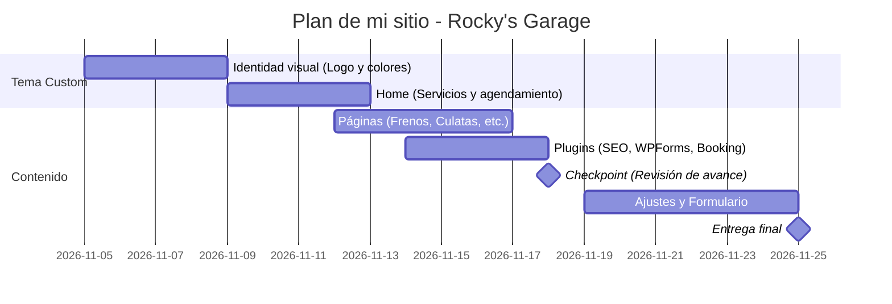
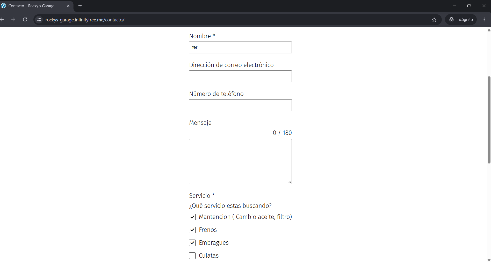
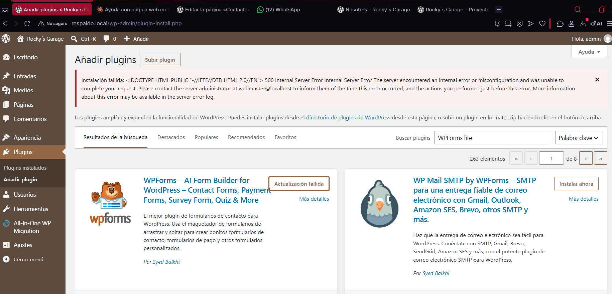
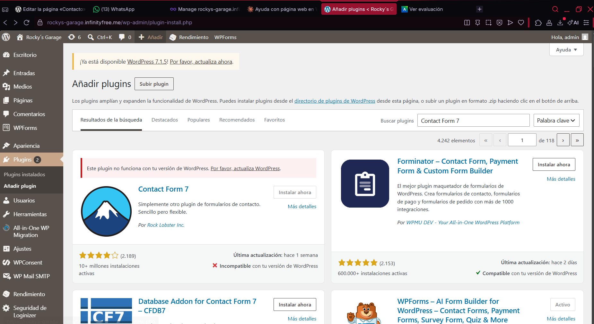

## Decisiones de mi sitio

**Emprendimiento:** Rocky's Garage (Servicio Automotriz - Villa Alemana)  
**Fecha:** 25 de noviembre de 2026 · **Última corrección:** 18 de noviembre de 2026

---

## 1. Plugins (10 pts)

| # | Funcionalidad | Plugin | Gratis o de pago | Qué incluye la versión gratis | Probado hasta (WP) | Requiere PHP | ¿Funciona con tema propio? | Enlace a la ficha |
|---|---|---|---|---|---|---|---|---|
| 1 | SEO (obligatorio) | Yoast SEO | Gratis | Títulos meta, descripciones, sitemap XML y optimización SEO local para búsquedas en Villa Alemana. | 6.7 | 7.4+ | Sí | [Ficha Yoast SEO](https://wordpress.org/plugins/wordpress-seo/) |
| 2 | Contacto (obligatorio) | WPForms | Gratis | Formulario de contacto drag-and-drop, recepción de consultas por correo y anti-spam. | 6.7 | 7.2+ | Sí | [Ficha WPForms](https://wordpress.org/plugins/wpforms-lite/) |
| 3 | Reserva de Horas / Citas | Booking Calendar | Gratis | Calendario para agendar revisiones de mecánica ligera, embargues o mantenciones. | 6.7 | 7.4+ | Sí | [Ficha Booking Calendar](https://wordpress.org/plugins/booking/) |
| 4 | Botón Directo a WhatsApp | Joinchat | Gratis | Botón flotante para cotizar trabajos (culatas, frenos, mantenciones) rápido vía WhatsApp. | 6.7 | 7.2+ | Sí | [Ficha Joinchat](https://wordpress.org/plugins/creame-whatsapp-me/) |
| 5 | Optimización de Imágenes | Smush | Gratis | Compresión automática de imágenes de trabajos del taller sin perder calidad de carga. | 6.7 | 7.4+ | Sí | [Ficha Smush](https://wordpress.org/plugins/wp-smushit/) |

---

## 2. Páginas de la fase 1 (5 pts)

| # | Página | Por qué la elijo (una línea) |
|---|---|---|
| 1 | **Inicio (obligatoria)** | Presentación del taller en Villa Alemana, llamado a la acción y resumen de especialidades mecánicas. |
| 2 | **Contacto (obligatoria)** | Ubicación en Villa Alemana, mapa interactivo, redes sociales (@rg.automotriz_) y formulario directo. |
| 3 | **Servicios** | Detalle de especialidades: mantenciones generales, frenos, embrague, culatas y mecánica ligera. |
| 4 | **Nosotros** | Historia del garage, experiencia técnica y garantías para generar confianza con los clientes. |
| 5 | **Agendar Hora** | Formulario exclusivo para cotizar o solicitar hora de revisión en el taller. |

**Páginas que dejo para después:**
* Tienda online de repuestos y fluidos automotrices (WooCommerce).
* Blog de tips de mantenimiento preventivo y cuidados mecánicos.
* Preguntas Frecuentes (FAQ sobre garantías y tiempos de reparación).

---

## 3. Plan del tema (5 pts)

* **Nombre del tema:** Rocky Garage Theme
* **Custom o descargado:** Custom, porque permite maquetar a medida los servicios de mecánica ligada y mantener una carga ultra rápida sin código innecesario.
* **Carta Gantt del desarrollo del sitio (5 al 25 de noviembre):**

| Etapa | Desde | Hasta | Notas |
|---|---|---|---|
| Identidad visual | 5 nov | 8 nov | Definición de colores, tipografía, logo de Rocky's Garage y assets visuales. |
| Home | 9 nov | 12 nov | Maquetación de la página principal y llamado a la acción para agendar horas. |
| Páginas | 12 nov | 15 nov | Creación del contenido para Servicios, Nosotros, Contacto y Agendar Cita. |
| Plugins | 14 nov | 17 nov | Instalación y configuración de Yoast SEO, WPForms, Booking Calendar, etc. |
| Checkpoint (18 nov) | 18 nov | 18 nov | Revisión de avance, correcciones de retroalimentación y control de commits. |
| Ajustes y formulario | 19 nov | 24 nov | Pruebas de funcionamiento del formulario de contacto, reservas y diseño responsive. |
| Entrega final (25 nov) | 25 nov | 25 nov | Subida del sitio final, optimización de velocidad y entrega definitiva del repositorio. |

Ejemplo con Mermaid (GitHub lo muestra como gráfico):

## 4. Plan B (5 pts)

Qué hago si algo no funciona. **Al menos 3 riesgos**, cada uno con su mitigación y cuándo se activa.

| Riesgo | Qué hago | Cuándo se activa (fecha o señal) |
|---|---|---|
| El tema propio no funciona o se rompe | Activar un tema base gratuito y compatible (como *Astra* o *GeneratePress*) y maquetar los servicios de mecánica mediante bloques de Gutenberg y CSS personalizado. | Si al 15 de noviembre persisten errores fatales de PHP o problemas graves de maquetado en el tema propio. |
| Un plugin falla o no es compatible | Desactivar el plugin problemático y sustituirlo por una alternativa equivalente (ej: cambiar *WPForms* por *Contact Form 7*, o *Booking Calendar* por *Simply Schedule Appointments*). | Inmediatamente al detectar un error 500, pantalla blanca ("White Screen of Death") o fallos visuales en el sitio tras activar el plugin. |
| Problemas de servidor o límites en InfinityFree | Desplegar el sitio en un entorno local (*LocalWP* o *XAMPP*) para finalizar el desarrollo y realizar la migración al hosting mediante *Duplicator*. | Si el hosting gratuito se cae de manera continua o excede los límites de uso de CPU/RAM antes del checkpoint del 18 de noviembre. |

---

## Cambios respecto de la Sumativa 2 (solo en el checkpoint del 18 nov)

| Qué cambié | Qué había antes | Por qué | Evidencia (captura o commit) |
|---|---|---|---|
| Forminator en vez de WPForms para el formulario de contacto | WPForms | WPForms falló al instalarlo en local (error 500) y Contact Form 7 salió incompatible con la versión de WordPress del hosting |    |

**Decisión:** Continúo con mi propuesta, con un ajuste en el plugin de formularios*.
