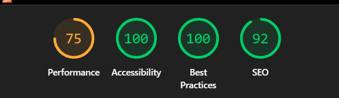

# Análisis de rendimiento con Lighthouse

**Sitio analizado:** https://rockys-garage.infinityfree.me (página de inicio, en producción)
**Herramienta:** Lighthouse en Chrome (DevTools, F12)
**Dispositivo:** móvil
**Fecha del análisis:** 25 de noviembre de 2026

## 1. Resultados (1 pt)

| Categoría | Puntaje (0 a 100) |
|---|---|
| Rendimiento | 75 |
| Accesibilidad | 100 |
| Buenas prácticas | 100 |
| SEO | 92 |

**Evidencia:** captura del informe en `lighthouse-movil.png` (misma carpeta `proyecto/`).

## 2. Análisis (1 pt)
 
- **Qué significan mis puntajes:**
  - **Rendimiento** mide qué tan rápido carga y se vuelve usable la página en el celular: cuánto tarda en mostrar el contenido principal, si el diseño se mueve mientras carga y cuánto pesa lo que descarga.
  - **Accesibilidad** mide si personas con dificultades visuales, motrices u otras pueden usar el sitio: contraste de colores, textos alternativos en las imágenes, nombres en los enlaces y los botones.
  - **Buenas prácticas** revisa aspectos técnicos de calidad y seguridad, como usar HTTPS, no tener errores en la consola del navegador y cargar imágenes con proporciones correctas.
  - **SEO** revisa lo básico para que Google pueda entender la página: título, descripción meta, enlaces rastreables y que se vea bien en móvil.
  - En mi caso, Accesibilidad y Buenas prácticas salieron en 100, SEO en 92 y Rendimiento en 75, que es el resultado más bajo.
- **Mi mejor categoría y por qué:** Accesibilidad y Buenas prácticas, con 100. El sitio usa HTTPS y no muestra errores técnicos, y el tema tiene buen contraste y textos legibles.
- **Mi categoría más débil y por qué:** Rendimiento, con 75. La causa principal es el LCP (Largest Contentful Paint) de 6,8 s, que Lighthouse marca en rojo: es lo que tarda en aparecer el elemento más grande de la pantalla, que en mi inicio es probablemente la foto del motor (en la secuencia de carga del informe se ve que primero aparecen el logo y el texto, y la foto llega después). El resto de las métricas está bien: TBT 0 ms, CLS 0 y Speed Index 2,2 s, y el FCP de 2,1 s está en naranja.
- **Problemas que encontré en el informe:**
  1. **LCP muy alto (6,8 s):** el contenido principal tarda en aparecer en un celular con 4G lenta simulada.
  2. **Use efficient cache lifetimes (ahorro estimado de 5 KiB):** algunos archivos del sitio no tienen un tiempo de caché largo, así que el navegador los vuelve a descargar en cada visita.
  3. **Optimize viewport for mobile:** Lighthouse avisa que el viewport no está optimizado para móvil, lo que puede retrasar la respuesta a los toques.
  4. **Avoid long main-thread tasks:** encontró 3 tareas largas del hilo principal (es un diagnóstico y no afecta directamente el puntaje).
  5. **SEO: "Document does not have a meta description":** a la página de inicio le falta la descripción meta. Es el único ítem fallido de SEO y explica por qué saqué 92 y no 100.
  6. Los apartados "LCP breakdown" y "LCP request discovery" aparecieron con "Error!", posiblemente por la redirección de la URL (`/?i=1` a `/?i=2`) que Lighthouse advirtió al inicio del informe.
**Límites del hosting gratuito:** InfinityFree tiene recursos compartidos y poco control del servidor (por ejemplo, la caché de código de PHP está desactivada y no hay CDN), por lo que el tiempo de respuesta puede ser más lento de lo que sería en un hosting de pago. Esto influye en mi puntaje de rendimiento y no depende solo de mi tema. Además, la protección anti-bots de InfinityFree agrega `?i=1` o `?i=2` a la URL y redirige la visita, y Lighthouse avisó que esto puede afectar la medición, por lo que el puntaje puede variar entre ejecuciones.
 
## 3. Mejoras (1 pt)
 
| Mejora | Qué problema resuelve | ¿Aplicada o propuesta? | Resultado (si la aplicaste) |
|---|---|---|---|
| Comprimir y redimensionar las imágenes, sobre todo la foto del motor de la página de inicio | LCP de 6,8 s: la imagen principal tarda en cargar en móvil | Propuesta | — |
| Activar la caché con W3 Total Cache (ya instalado) y definir tiempos de caché largos para archivos estáticos | "Use efficient cache lifetimes" y respuesta lenta del servidor | Propuesta | — |
| Agregar una descripción meta a la página de inicio y a las demás páginas (con un plugin de SEO o manualmente) | "Document does not have a meta description": SEO en 92 en vez de 100 | Propuesta | — |
| Pasar a un hosting de pago con PHP optimizado | Tiempo de respuesta lento del servidor gratuito | Propuesta (etapa 2, ver `plan-de-continuidad.md`) | — |
